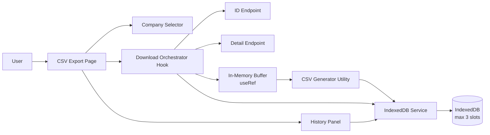
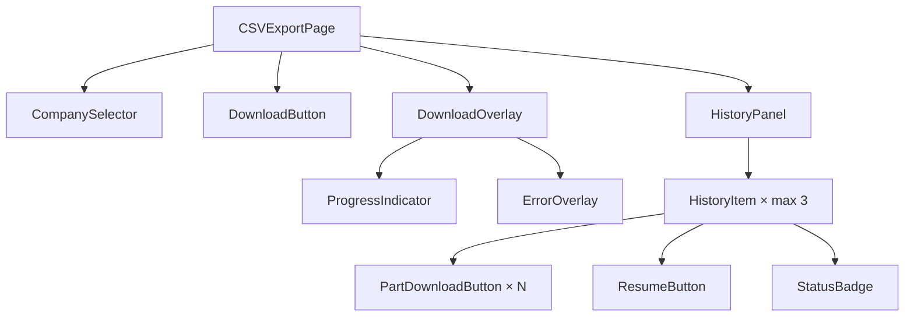
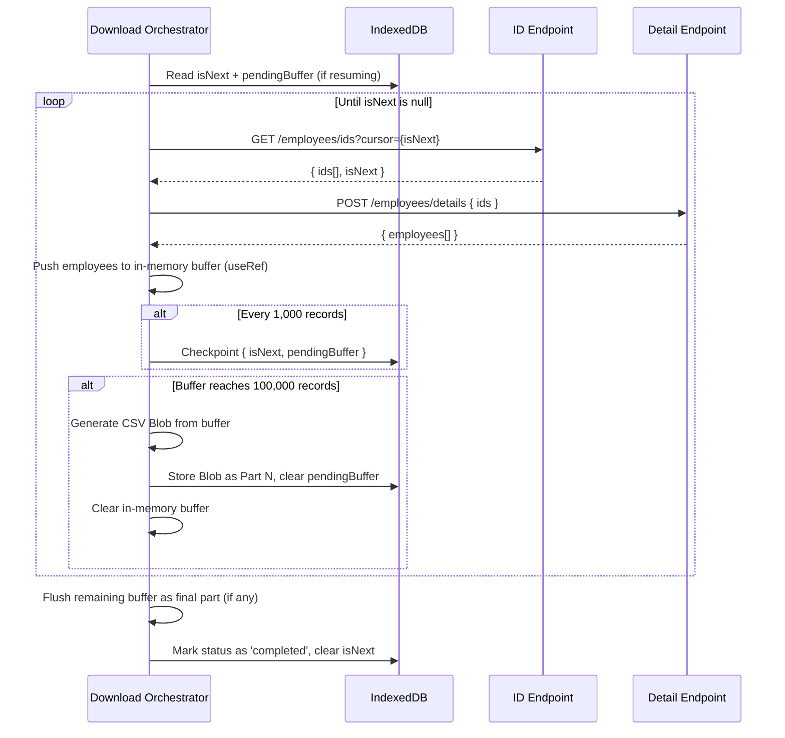
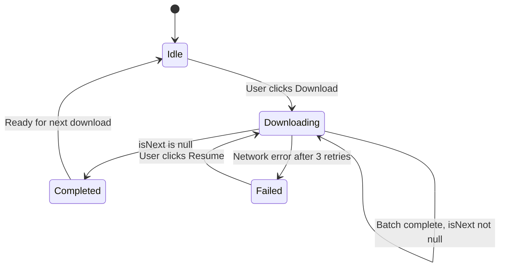

# Employee CSV Bulk Export — AFF PRCNG TECHSOL

## 0. Document Info

| Field | Value |
|---|---|
| Status | Draft |
| Owner | |
| Reviewers | FE TL, BE, QA, PM |
| Related Jira | |
| Related Figma | |
| Related PRD / Requirement | |
| Related API Contract | |
| Related Storybook | |
| Target Release | |
| Last Updated | 2026-06-21 |

---

## 1. Executive Summary

- **Problem:** There is currently no mechanism to export employee data per company in bulk. Employee records are accessible only through a paginated API (50 records per call), and the full dataset per company can reach 600,000 records. Fetching and exporting this volume naively would either exhaust browser memory or produce no usable output if interrupted.

- **Selected approach:** A client-side sequential fetch loop driven by cursor pagination. The page fetches IDs 50 at a time, retrieves employee details per batch, and accumulates records in an in-memory buffer. Every 1,000 records, the cursor and buffer are checkpointed to IndexedDB for crash recovery. Every 100,000 records, a CSV part is generated and persisted to IndexedDB. The UI is blocked by a download overlay during the process — one download at a time, synchronous, resumable.

- **Main FE changes:** New CSV Export page, Download Orchestrator custom hook, IndexedDB service, CSV generator utility, Download History panel.

- **Main dependencies:** ID Endpoint (cursor-paginated list of employee IDs), Detail Endpoint (batch employee detail lookup by ID), browser IndexedDB API.

- **Main risk:** The full download process for 600K records runs for an extended duration (~40 minutes at typical latency). A tab close or crash loses the in-memory buffer, but recovery is bounded to at most 1,000 re-fetched records from the last checkpoint.

- **Rollout plan:** PoC with mock APIs → staging validation with real APIs → production behind feature flag → full rollout.

---

## 2. Background & Problem

**Current Condition**
- No CSV export feature exists for employee data.
- Employee records are accessible only via API, with pagination capped at 50 IDs per response.

**Problem**
- Business requires bulk export of employee data per company for downstream processing (reporting, payroll, compliance).
- A single company can have up to 600,000 employees. A naive approach (accumulate all in memory, then export) would either crash the browser tab or produce no file if the process is interrupted.
- Without crash recovery, any interruption forces a full restart, wasting potentially hours of fetch time.

**Why Now**
- New business requirement. A PoC is needed to validate the approach before committing to full production implementation.

**Affected Pages / Journeys**
- New: Employee CSV Export page (standalone page, not embedded in an existing flow)

---

## 3. Goals & Non-Goals

| Goals | Non-Goals |
|---|---|
| Enable bulk export of employee data per company as split CSV files | Server-side CSV generation |
| Support cursor-based pagination to fetch all records regardless of total count | Background (non-blocking) download |
| Persist download progress and completed parts in IndexedDB for crash recovery | Concurrent downloads for multiple companies simultaneously |
| Allow users to resume an interrupted or failed download from the last checkpoint | Custom column selection or column ordering |
| Maintain a download history of the last 3 companies (FIFO eviction on 4th) | Export formats other than CSV |
| Split CSV output into parts at a 100,000-record threshold | Re-fetching completed parts on resume (only resume from cursor) |

---

## 4. Scope & Impacted Areas

| Area | Impact | Owner | Notes |
|---|---|---|---|
| CSV Export Page | New | FE | Standalone page; includes selector, overlay, and history panel |
| Download Orchestrator Hook | New | FE | Core fetch loop logic; cursor handling, buffer, retry, checkpoint |
| IndexedDB Service | New | FE | CRUD + eviction for max-3 history slots |
| CSV Generator Utility | New | FE | RFC 4180 compliant; produces Blob per part |
| Download History Panel | New | FE | Reads IndexedDB; renders per-part download buttons and resume |
| ID Endpoint | Existing — read-only | BE | FE consumes as-is; no BE changes required |
| Detail Endpoint | Existing — read-only | BE | FE consumes as-is; no BE changes required |

---

## 5. Proposed Solution

### 5.1 Solution Overview

The CSV Export page owns the entire download orchestration. When the user selects a company and clicks Download:

1. The Download Orchestrator hook starts a sequential loop: call the ID Endpoint with the current cursor → call the Detail Endpoint with the returned 50 IDs → push employee records into an in-memory buffer (`useRef`).
2. Every 1,000 records, the current cursor (`isNext`) and the pending buffer are checkpointed to IndexedDB.
3. When the buffer reaches 100,000 records, a CSV blob is generated, stored in IndexedDB as Part N, and the buffer is cleared.
4. When the ID Endpoint returns `isNext: null`, the loop ends. Any remaining records in the buffer are flushed as a final CSV part. The history entry is marked `completed`.
5. Throughout the process, a full-screen overlay blocks all UI interaction. The user can only stop by closing the tab (which is recoverable from the last checkpoint).

On Resume, the orchestrator reads the stored `isNext` and pending buffer from IndexedDB and continues from that point.

The main idea is: **the page is the orchestrator, IndexedDB is the safety net, and the in-memory `useRef` buffer is the working set** — never kept large enough to cause memory issues, never triggering unnecessary re-renders.

### 5.2 High-Level Architecture



### 5.3 Main Design Decisions

| Decision | Reason |
|---|---|
| `useRef` for the in-memory record buffer, not `useState` | A 600K record export triggers ~12,000 buffer pushes. Using `useState` would cause 12,000+ React re-renders and make the UI unresponsive. `useRef` holds the buffer with zero re-render cost. |
| IndexedDB keyed by `companyId`, max 3 slots, FIFO eviction | Each company has a stable, unique key. When a 4th company download starts, the oldest entry (by `createdAt`) is deleted from IndexedDB and removed from the UI. |
| Hybrid storage: JSON for pending buffer, CSV Blob for completed parts | Completed parts don't need to be appended to; they're sealed. Storing them as CSV Blob is more compact than JSON and ready for immediate browser download. Only the pending (not-yet-at-100K) records are kept as JSON for resumability. |
| Synchronous blocking UI (download overlay) | Eliminates concurrency and race condition complexity. One download at a time. The overlay provides clear feedback and prevents the user from starting a second download accidentally. |
| Checkpoint every 1,000 records | On tab close and resume, at most 1,000 records need to be re-fetched (those in the pending buffer since last checkpoint). Balances recovery granularity against IndexedDB write frequency. |
| 100K records per CSV part | Each part is ~10MB — well within browser Blob and download limits. Six parts for a 600K record export. Avoids generating one giant Blob in memory. |
| Resume = same history entry, not a new one | Resume continues the existing history slot. `createdAt` is preserved; `updatedAt` and `status` are updated. Completed parts remain downloadable while resume is in progress. |

---

## 6. Rendering & Data Fetching Strategy

| Concern | Decision | Reason |
|---|---|---|
| Rendering mode | CSR (Client-Side Rendering) | The feature is entirely user-triggered; no data is needed at initial page render. SSR would add complexity with no benefit. |
| Data fetching | Native `fetch` in a procedural loop (no React Query) | The download loop is imperative and stateful (cursor, buffer, retry count). React Query's declarative model is not suited to a sequential loop that must be paused, resumed, and aborted. |
| Cache | No HTTP cache; IndexedDB for cross-session persistence | API data must be fresh at download time. IndexedDB stores completed parts and the current cursor for recovery across sessions and tab closes. |
| Revalidation | On user request only (Download or Resume button) | No polling or automatic refresh; the process is user-initiated. |
| Error fallback | Inline error overlay within the Download Overlay | Shows "Download failed" message, lists completed parts available for download, and shows a Resume button. Raw API error details are not exposed. |

---

## 7. Component Design

### 7.1 Component Tree



### 7.2 Component Responsibility

| Component | Responsibility | State Owner | Notes |
|---|---|---|---|
| CSVExportPage | Coordinates selector, download hook, overlay visibility, and history refresh | `useState` for `activeDownload`, `overlayVisible`, `selectedCompany` | Top-level orchestrator |
| CompanySelector | Renders dropdown of companies; emits `companyId` on change | CSVExportPage | Disabled when `activeDownload` is true |
| DownloadButton | Triggers download start; disabled during active download or when no company selected | CSVExportPage | |
| DownloadOverlay | Blocks full UI during active download; renders progress and error states | `useDownloadOrchestrator` hook | Shown when `activeDownload` is true |
| ProgressIndicator | Displays records processed count and current part number | Props from hook | Throttled update every 1,000 records |
| ErrorOverlay | Shown on failure; renders available part download buttons and Resume button | Props from hook | Only visible when status is `failed` |
| HistoryPanel | Reads all history entries from IndexedDB; renders up to 3 `HistoryItem` components | Internal `useState`, refreshed after each download | Sorted by `createdAt` descending |
| HistoryItem | Renders company name, status badge, one download button per completed part, and Resume button if status is `failed` | Props only | Resume triggers `onResume(companyId)` |

---

## 8. Props & Component Contract

### `HistoryItem`

| Prop | Type | Required | Default | Description |
|---|---|---|---|---|
| `entry` | `HistoryEntry` | Yes | — | The full IndexedDB record for a company. Drives status badge, part list, and resume availability. |
| `onResume` | `(companyId: string) => void` | Yes | — | Called when user clicks Resume. Triggers orchestrator to resume from `entry.isNext`. Only rendered when `entry.status === 'failed'`. |
| `onDownloadPart` | `(blob: Blob, partNumber: number, companyName: string) => void` | Yes | — | Called when user clicks a part download button. Triggers a browser file download. |

### `DownloadOverlay`

| Prop | Type | Required | Default | Description |
|---|---|---|---|---|
| `status` | `'downloading' \| 'failed'` | Yes | — | Controls which sub-state (progress or error) is rendered. |
| `recordsProcessed` | `number` | Yes | — | Displayed in progress indicator; updates every 1,000 records. |
| `currentPart` | `number` | Yes | — | Current CSV part being assembled. |
| `completedParts` | `CompletedPart[]` | Yes | — | List of completed parts; rendered as download buttons in error state. |
| `onResume` | `() => void` | Yes | — | Called when user clicks Resume in error state. |

---

## 9. API Contract & Data Mapping

### ID Endpoint

**Method:** `GET /employees/ids`

**Request query params:**

| Param | Type | Required | Description |
|---|---|---|---|
| `companyId` | `string` | Yes | The selected company |
| `cursor` | `string` | No | The `isNext` value from the previous response. Omit on first call. |

**Response:**

```json
{
  "ids": ["emp_001", "emp_002", "...up to 50 items"],
  "isNext": "cursor_abc123"
}
```

| Field | Required | Notes |
|---|---|---|
| `ids` | Yes | Array of employee IDs; max 50 per response |
| `isNext` | Yes | `null` signals end of dataset; any string value signals more pages |

### Detail Endpoint

**Method:** `POST /employees/details`

**Request body:**

```json
{
  "ids": ["emp_001", "emp_002", "...up to 50 items"]
}
```

**Response:**

```json
{
  "employees": [
    {
      "id": "emp_001",
      "name": "Jane Doe",
      "age": 34,
      "dob": "1991-08-22",
      "address": "456 Oak Avenue, Springfield"
    }
  ]
}
```

### UI / CSV Field Mapping

| CSV Column | Source Field | Required | Fallback | Notes |
|---|---|---|---|---|
| ID | `employee.id` | Yes | Skip row | Row is excluded if ID is missing |
| Name | `employee.name` | Yes | `"-"` | |
| Age | `employee.age` | No | `"-"` | |
| Date of Birth | `employee.dob` | No | `"-"` | |
| Address | `employee.address` | No | `"-"` | Wrap in quotes; escape internal quotes |

### API Sequence — Cursor Loop



---

## 10. UI States



| Scenario | Expected UI | Notes |
|---|---|---|
| Initial load | Company selector enabled, Download button enabled, History panel populated from IndexedDB | History may be empty on first visit |
| Active download | Full-screen overlay with progress counter (records processed, current part); all controls disabled | User cannot interact with selector or history |
| Download complete | Overlay dismissed; history entry updated to `completed`; all parts show Download button | History panel auto-refreshes |
| API failure (3 retries exhausted) | Error overlay shown within download overlay; lists completed parts with download buttons; shows Resume button | `status` set to `failed` in IndexedDB |
| Resume in progress | Same overlay as active download; progress continues from last checkpoint record count | Existing completed parts remain downloadable during resume |
| Tab close and return | History panel shows interrupted download as `failed`; Resume and available part buttons visible | Recovery bounded to ≤1,000 re-fetched records |
| History full (3 slots), new download starts | Oldest entry evicted from IndexedDB and removed from history panel; new entry added | No confirmation prompt in PoC |
| Empty ID response (`ids: []`, `isNext: null`) | Download completes with 0 records; history entry shows `completed` with 0 parts | Edge case; no CSV parts generated |

---

## 11. Analytics & Tracking

Not in scope for this PoC. Events to consider in production:

| Event | Trigger | Payload | Owner |
|---|---|---|---|
| `csv_download_started` | User clicks Download | `companyId`, `companyName` | FE |
| `csv_part_completed` | Buffer reaches 100K threshold | `companyId`, `partNumber`, `recordCount` | FE |
| `csv_download_completed` | `isNext` returns null | `companyId`, `totalParts`, `totalRecords` | FE |
| `csv_download_failed` | 3 retries exhausted | `companyId`, `failedAt` (record count), `partNumber` | FE |
| `csv_download_resumed` | User clicks Resume | `companyId`, `resumeFromRecord` | FE |

---

## 12. Performance Considerations

| Concern | Decision |
|---|---|
| Bundle size | No external CSV library; CSV generation uses native string operations. No new heavy dependencies introduced. |
| Network requests | Sequential loop: one ID Endpoint call → one Detail Endpoint call per 50 records. For 600K records: ~12,000 ID calls + ~12,000 Detail calls. No parallelism to avoid server-side rate limiting. |
| Cache | No HTTP cache for API calls (data must be fresh at download time). IndexedDB used only for checkpoint and completed part persistence. |
| Rendering | `useRef` for the data buffer ensures zero re-renders during record accumulation. Progress counter (`useState`) throttled to update every 1,000 records to limit renders to ~600 updates for a 600K record export. |
| Re-render | Only UI-facing state (`recordsProcessed`, `currentPart`, `status`) is in `useState`. Data buffer is entirely in `useRef`. |
| In-memory usage | Peak buffer: 100K records × ~200 bytes (JSON) = ~20MB. Acceptable for a modern browser tab. Buffer is cleared after each CSV part is written to IndexedDB. |
| IndexedDB storage | Max: 3 companies × 6 parts × ~10MB per part = ~180MB. Within typical IndexedDB quota on modern browsers. |

---

## 13. Security & Permission

| Concern | Decision |
|---|---|
| Auth | API calls include auth token in request headers following the existing application auth pattern. The token is read from the existing session/auth context. |
| Permission | The CSV Export page is accessible only to authorized users. Gated by the existing app permission system. Download button is not rendered for unauthorized users. |
| Sensitive data | Employee PII (name, date of birth, address) is stored in IndexedDB. IndexedDB is same-origin only — data is not exposed to other origins. Data for an evicted history slot is deleted from IndexedDB immediately on eviction. |
| Storage | Sensitive data is kept only in IndexedDB, not in `localStorage` or `sessionStorage`. No PII is logged to the console. |
| XSS | CSV field values are escaped per RFC 4180: each field is wrapped in double quotes; internal double quotes are doubled (`""`). This also prevents CSV injection attacks. No raw HTML is rendered anywhere in the feature. |
| API error exposure | Raw API error messages and status codes are caught and not surfaced to the UI. The UI shows only a generic "Download failed. Please try again." message. |

---

## 14. Testing Strategy

| Level | Scope | Owner |
|---|---|---|
| Unit Test | CSV generator utility, IndexedDB service, Download Orchestrator hook | FE |
| Integration Test | Full download loop with mocked API responses | FE |
| Manual QA | End-to-end with staging or real API | QA |

### Test Scenarios

| Scenario | Given | When | Then |
|---|---|---|---|
| Successful full export | Company selected, no existing history, APIs return data for 600K records | User clicks Download | All 6 CSV parts are generated, history shows `completed`, all part download buttons are active |
| Progress counter updates correctly | Active download in progress | 50,000 records are processed | Progress indicator shows 50,000 records and Part 1 in progress |
| Resume after tab close (within checkpoint window) | Download interrupted at record 75,000 (checkpoint at 74,000) | User returns to page, clicks Resume | Download resumes from record 74,000; existing Part 1 (if completed) remains downloadable; at most 1,000 records re-fetched |
| Network failure triggers error state | Download in progress, API begins returning errors | API errors for 3 consecutive retry attempts | Error overlay shown; completed parts are downloadable; Resume button visible |
| History eviction on 4th company | 3 history slots occupied | User downloads a 4th company | Oldest history entry removed from IndexedDB and UI; new entry added; total remains 3 |
| CSV injection is prevented | Employee name contains `=SUM(1+1)` or internal quotes | CSV part is generated | Field is wrapped in double quotes and internal quotes are escaped; no formula injection |
| Empty dataset export | ID Endpoint returns `{ ids: [], isNext: null }` on first call | User clicks Download | Download completes immediately with 0 parts; history shows `completed (0 records)` |

---

## 15. Rollout & Migration Plan

| Phase | Scope | Rollout Strategy | Success Criteria |
|---|---|---|---|
| Phase 1: PoC | Internal PoC environment with mock APIs | Manual deploy to PoC environment; no feature flag needed | Full download loop works end-to-end; IndexedDB persistence and resume verified; CSV parts open correctly |
| Phase 2: Staging | Staging environment with real API endpoints | Feature flag enabled for internal users only | No errors in staging; CSV data matches source; resume after forced tab close works; QA sign-off |
| Phase 3: Full rollout | All users | Remove feature flag; monitor error rates for 1 week | No reported data loss or CSV corruption; error rate below threshold |
| Rollback | All phases | Disable feature flag (Phase 2–3); revert PR (Phase 1) | Feature is hidden; no data loss risk as all data is client-local in IndexedDB |

---

## 16. Risks, Trade-offs, and Open Questions

### Risks

| Risk | Impact | Mitigation |
|---|---|---|
| Long-running process (~40 min for 600K records) causes user frustration or tab abandonment | High | Display clear progress (records processed, estimated parts remaining); show a notice that the tab must stay open; support resume on return |
| Browser tab throttling (background tab CPU/network throttling) slows the fetch loop | Medium | UI copy instructs user to keep the tab in the foreground; acceptable limitation for PoC |
| IndexedDB storage quota exceeded (~180MB for 3 full companies) | Medium | Add a visible storage usage estimate in the history panel; prompt user to download and clear completed parts they no longer need |
| API contract for ID or Detail Endpoint changes during development | Medium | Lock down the API contract with BE before FE implementation begins; document the contract in this document as the single source of truth |
| CSV injection via employee data fields | Low–Medium | All fields are RFC 4180 escaped (double-quote wrap + internal quote doubling); covered by unit tests |

### Trade-offs

| Option | Pros | Cons | Decision |
|---|---|---|---|
| Store raw JSON records in IndexedDB for all data | Flexible; easy to re-generate CSV at any time | More storage than CSV Blob; requires in-browser CSV re-generation at download time | Hybrid: JSON only for pending buffer; completed parts stored as CSV Blob |
| Use a Web Worker for the fetch loop | Non-blocking main thread; UI stays fully responsive | More complex setup; auth token must be passed to worker context; increases PoC scope | Not used for PoC. Main thread with blocking overlay is sufficient and simpler |
| Auto-trigger browser download at each 100K threshold | Immediate delivery to user | Blocked by browser popup blockers after the first auto-download | Manual "Download Part N" buttons in history UI |

### Open Questions

| Question | Owner | Due Date | Status |
|---|---|---|---|
| What auth mechanism do the ID and Detail Endpoints require? (Bearer token, cookie, API key?) | BE | — | Open |
| Is there a server-side rate limit on either endpoint that FE must respect (e.g., max N requests/second)? | BE | — | Open |
| Is the `isNext` cursor format stable across sessions (e.g., is it safe to store for hours and reuse)? | BE | — | Open |
| Should the history eviction show a confirmation dialog before deleting the oldest entry? | PM / Design | — | Open |

---

## 17. Implementation Plan

| Task | Owner | Estimate | Notes |
|---|---|---|---|
| Build IndexedDB service (schema, read, write, checkpoint, evict) | FE | 2d | Handles max-3 slot management; written as a plain async module (no React dependency) |
| Build CSV generator utility with RFC 4180 escaping | FE | 1d | Pure function; input: `EmployeeRecord[]`; output: `Blob` |
| Build Download Orchestrator hook (`useDownloadOrchestrator`) | FE | 3d | Sequential cursor loop, `useRef` buffer, retry with exponential backoff, checkpoint writes, part flush |
| Build CSV Export Page UI (selector, download button, overlay, history panel) | FE | 2d | Integrates hook, IndexedDB service; renders all UI states |
| Unit tests for CSV utility, IndexedDB service, orchestrator hook | FE | 1d | |
| Integration test for full download loop with mocked APIs | FE | 1d | Cover happy path, mid-download failure, resume |
| Manual QA with staging API | QA | 2d | Verify CSV correctness, resume recovery, history eviction |

---

## 18. Appendix

### Appendix A — Full API Sample Responses

**ID Endpoint — mid-pagination response:**
```json
{
  "ids": [
    "emp_001", "emp_002", "emp_003",
    "...47 more items"
  ],
  "isNext": "cursor_xk92mz"
}
```

**ID Endpoint — last page response:**
```json
{
  "ids": ["emp_599998", "emp_599999", "emp_600000"],
  "isNext": null
}
```

**Detail Endpoint response:**
```json
{
  "employees": [
    {
      "id": "emp_001",
      "name": "Jane Doe",
      "age": 34,
      "dob": "1991-08-22",
      "address": "456 Oak Avenue, Springfield"
    },
    {
      "id": "emp_002",
      "name": "John Smith",
      "age": 29,
      "dob": "1996-03-11",
      "address": "789 Pine Road, Shelbyville"
    }
  ]
}
```

### Appendix B — IndexedDB Schema

```typescript
interface EmployeeRecord {
  id: string;
  name: string;
  age: number | null;
  dob: string | null;
  address: string | null;
}

interface CompletedPart {
  partNumber: number;
  blob: Blob;
  recordCount: number;
}

interface HistoryEntry {
  companyId: string;
  companyName: string;
  status: 'in-progress' | 'completed' | 'failed';
  isNext: string | null;
  pendingBuffer: EmployeeRecord[];   // records accumulated since last completed part
  completedParts: CompletedPart[];
  totalRecordsProcessed: number;
  createdAt: number;                 // Unix ms timestamp
  updatedAt: number;                 // Unix ms timestamp
}
```

**IndexedDB store name:** `csvExportHistory`
**Key path:** `companyId`
**Max entries:** 3 (enforced by service; oldest by `createdAt` is evicted when a 4th is inserted)

### Appendix C — CSV Part Format

CSV header row (always present, even for the final partial part):
```
id,name,age,dob,address
```

Example rows:
```
"emp_001","Jane Doe","34","1991-08-22","456 Oak Avenue, Springfield"
"emp_002","John ""JD"" Smith","29","1996-03-11","789 Pine Road, Shelbyville"
```

Rules:
- All fields are double-quoted
- Internal double quotes are escaped by doubling: `"` → `""`
- Null/missing fields are rendered as `"-"`
- Line endings: `\r\n` (RFC 4180)

### Appendix D — Retry Strategy

Each individual API call (ID Endpoint or Detail Endpoint) is retried up to 3 times before the download is marked as `failed`.

| Attempt | Delay before retry |
|---|---|
| 1st retry | 1 second |
| 2nd retry | 3 seconds |
| 3rd retry | 9 seconds |
| After 3rd failure | Mark download as `failed`, write checkpoint to IndexedDB, show error overlay |
